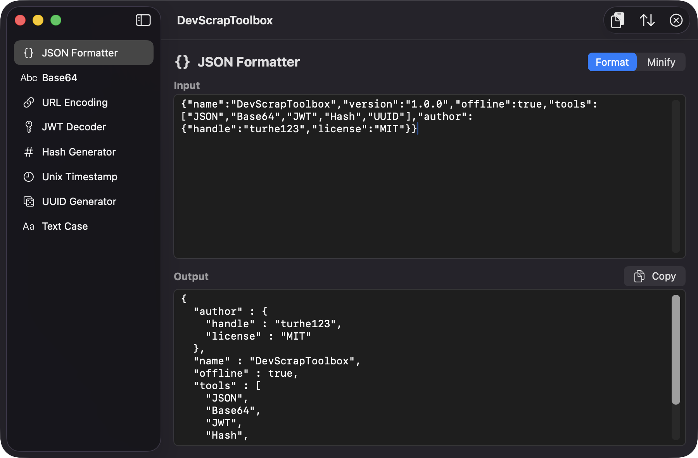
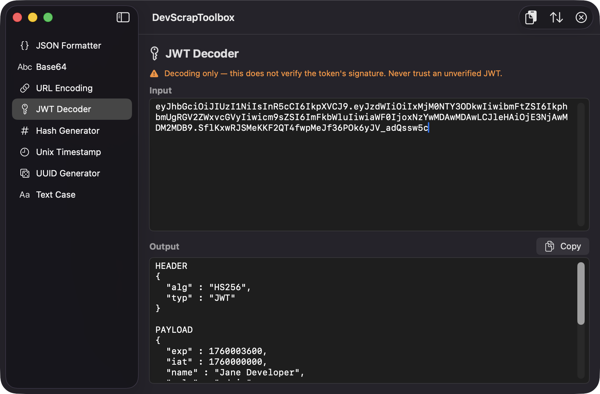
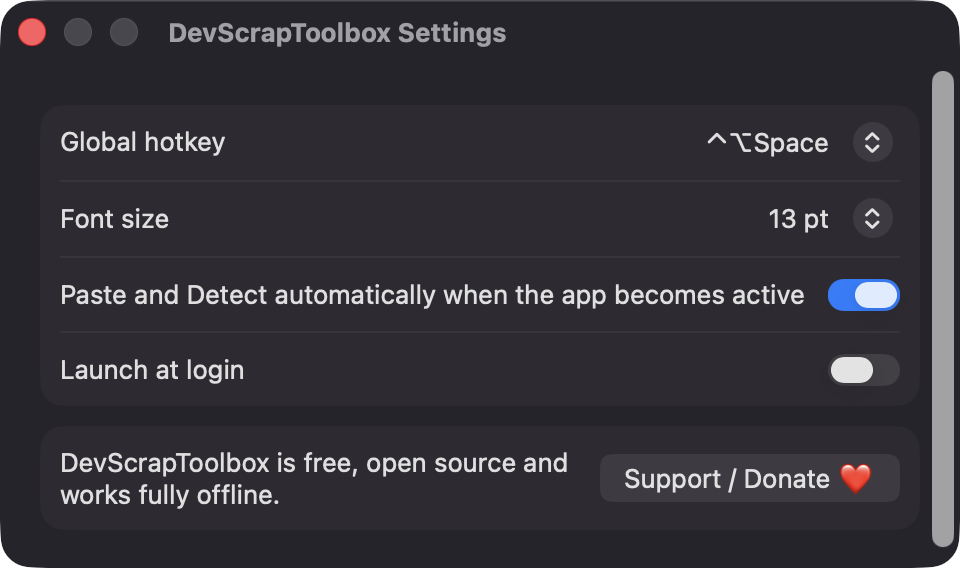
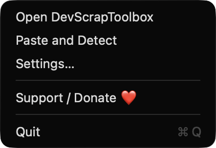

# DevScrapToolbox

**🌐 Website:** [turhe123.github.io/dev-scrap-toolbox](https://turhe123.github.io/dev-scrap-toolbox/)

An offline toolbox of everyday developer converters like JSON, [removed], JWT, hashes and timestamps, fed from your clipboard.


## Why

DevScrapToolbox is a free, open-source, 100% native, backend-free alternative to the paid utilities in the *Developer & Network* category. Tools like DevUtils ($9 one-time) were the inspiration: a fast, offline replacement for scattered web-based formatters. This project aims at the most-used subset of that idea, with nothing leaving your Mac.

## Features

- **Sidebar of tools**, each with an input pane, an output pane and a copy button.
- **JSON Formatter**: format (pretty-print, sorted keys) or minify, with validation. Errors show the line and column. Large inputs are processed off the main thread with a progress indicator.
- **Base64**: encode and decode (standard and URL-safe alphabets, missing padding tolerated). Non-UTF-8 output shows a hex preview and a **Save to file** button.
- **URL Encoding**: percent-encode and decode, with a clear error on malformed sequences.
- **JWT Decoder**: shows header and payload as pretty JSON, converts `exp`, `iat` and `nbf` to readable dates (flagging expired tokens), and reports which segment failed if the token is malformed. The signature is **not** verified, and the output says so.
- **Hash Generator**: MD5, SHA1, SHA256 and SHA512 of typed text, or of a file you drop on the window or pick with a file chooser. Files are streamed in 1 MB chunks.
- **Unix Timestamp**: seconds or milliseconds (detected by magnitude) or an ISO 8601 date, converted to local time, UTC, ISO 8601, relative time, seconds and milliseconds.
- **UUID Generator**: 1 to 10,000 UUIDs at once, lowercase or UPPERCASE.
- **Text Case**: camelCase, snake_case, kebab-case or UPPERCASE, line by line.
- **Paste and Detect** (⇧⌘V): reads the clipboard, guesses the type (JSON, JWT, timestamp, URL-encoded, Base64, otherwise text) and opens the matching tool pre-filled.
- **Swap** (moves output to input, flipping encode/decode where it applies) and **Clear** toolbar buttons.
- **Menu bar item** with Open, Paste and Detect, Settings and Support.
- **Global hotkey** to bring up the window from anywhere. Choose ⌃⌥Space, ⌘⇧D, ⌃⌥D, ⌘⌥J or Off.
- **Settings**: hotkey, editor font size (11 to 22 pt), auto-detect when the app becomes active, launch at login.

## Screenshots

<p align="center"></p>

<p align="center"><em>The JSON Formatter pretty-prints minified JSON with sorted keys, next to a sidebar of all eight developer tools.</em></p>

<p align="center"></p>

<p align="center"><em>Paste and Detect recognizes a JWT on the clipboard and decodes its header and payload, with a clear note that the signature is not verified.</em></p>

<p align="center"></p>

<p align="center"><em>Settings let you pick a global hotkey, editor font size, auto-detect on activation and launch at login.</em></p>

<p align="center"></p>

<p align="center"><em>The menu bar item gives quick access to Open, Paste and Detect, Settings and Support.</em></p>

## Install

1. Download `DevScrapToolbox-macOS.zip` from the [latest release](https://github.com/turhe123/dev-scrap-toolbox/releases/latest).
2. Unzip it and move `DevScrapToolbox.app` to `/Applications`.
3. Because the app is open source and not notarized, clear the quarantine flag:

   ```bash
   xattr -cr /Applications/DevScrapToolbox.app
   ```

4. Right-click the app and choose **Open** the first time.

Requires macOS 14.0 or later.

## Build from source

You need Xcode and [XcodeGen](https://github.com/yonaskolb/XcodeGen).

```bash
brew install xcodegen
xcodegen generate
xcodebuild -project DevScrapToolbox.xcodeproj -scheme DevScrapToolbox -configuration Release -derivedDataPath ./build build
```

The app is produced at `build/Build/Products/Release/DevScrapToolbox.app`.

## Permissions

DevScrapToolbox does not request any privacy permissions. It does not need Accessibility, Screen Recording or Microphone access, and none are used in the code. Here is what it does touch:

- **Clipboard**: reads the general pasteboard only when you use Paste and Detect, or when the app becomes active with auto-detect enabled (you can turn this off in Settings). Copy writes to it only when you press the copy button.
- **Files**: only files you drop on the Hash tool or choose in the open or save panel.
- **Global hotkey**: registered with Carbon `RegisterEventHotKey`, which needs no Accessibility permission.
- **Launch at login**: optional, via `SMAppService`. You can review it in System Settings › General › Login Items.

## Built with AI

DevScrapToolbox was written by [Claude Code](https://claude.com/claude-code) inside an automated pipeline, from a plain-English spec. No code, binaries or assets from any commercial app were used; it is a clean-room reimplementation of a feature set, not a copy.

What that means in practice:

- The full source is in this repo under the MIT license. Read it before you run it.
- No network calls, no analytics, no third-party dependencies. Only Apple frameworks.
- Ad-hoc signed and not notarized, which is why Gatekeeper warns on first launch.
- It has had less human review than a hand-written app. Bug reports and pull requests are welcome.

## Support ❤️

If this saves you a trip to a web formatter, you can support the author: [Support Or (Leo) Davidai ❤️](https://ko-fi.com/leodavidai). The app also has a **Support / Donate ❤️** button in Settings and the menu bar.

## License

MIT © Or Davidai Bachar

## More free Mac apps

Prefer something that runs in the browser? The same pipeline builds [free, private web tools](https://turhe123.github.io/web-tools/): PDF, image, developer, data and audio tools, nothing uploaded.
